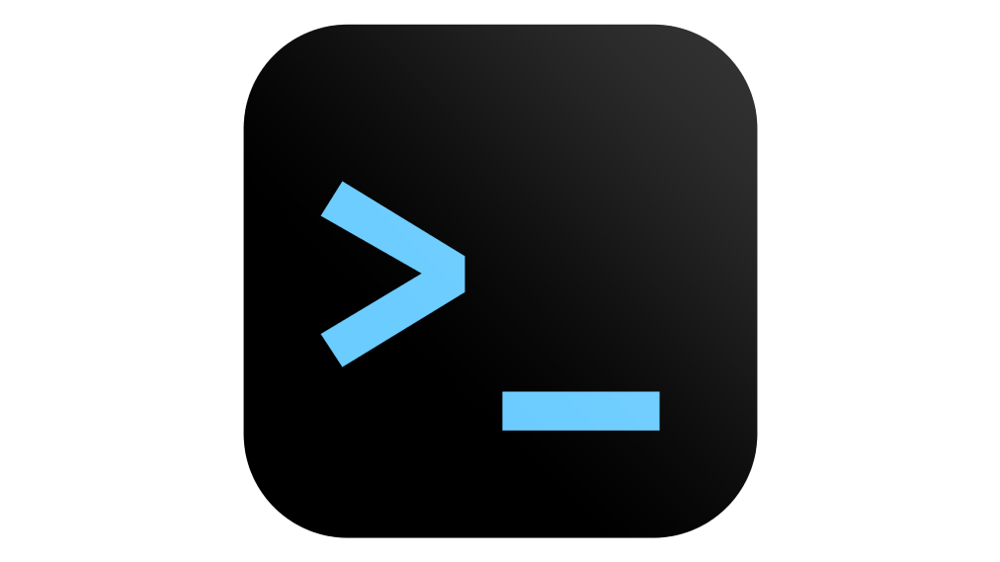
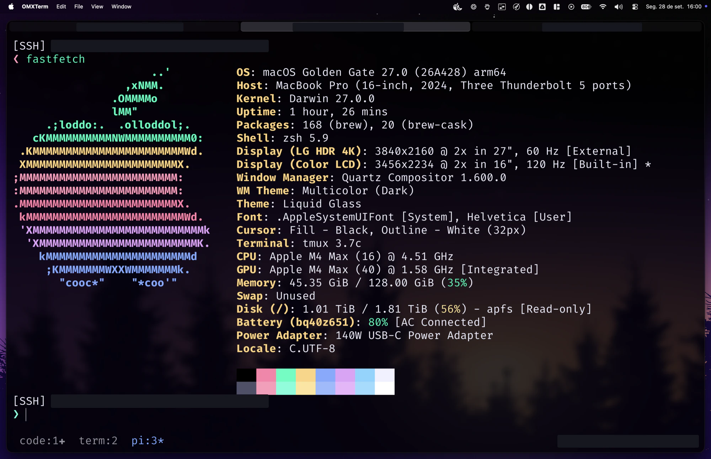
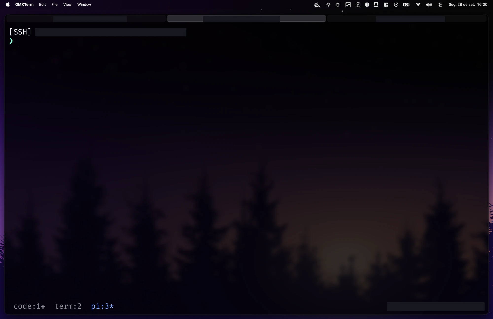
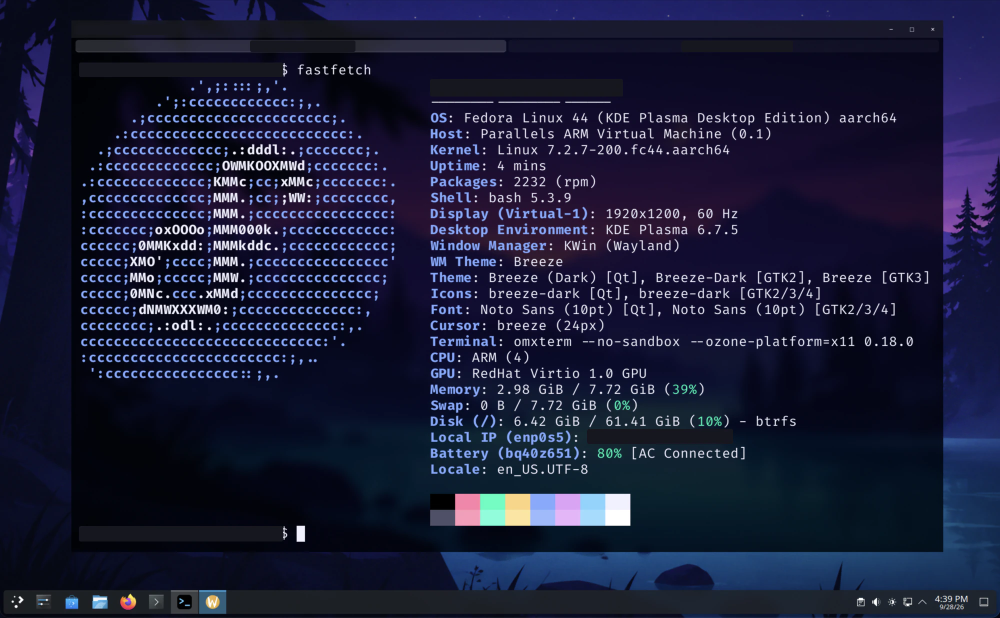
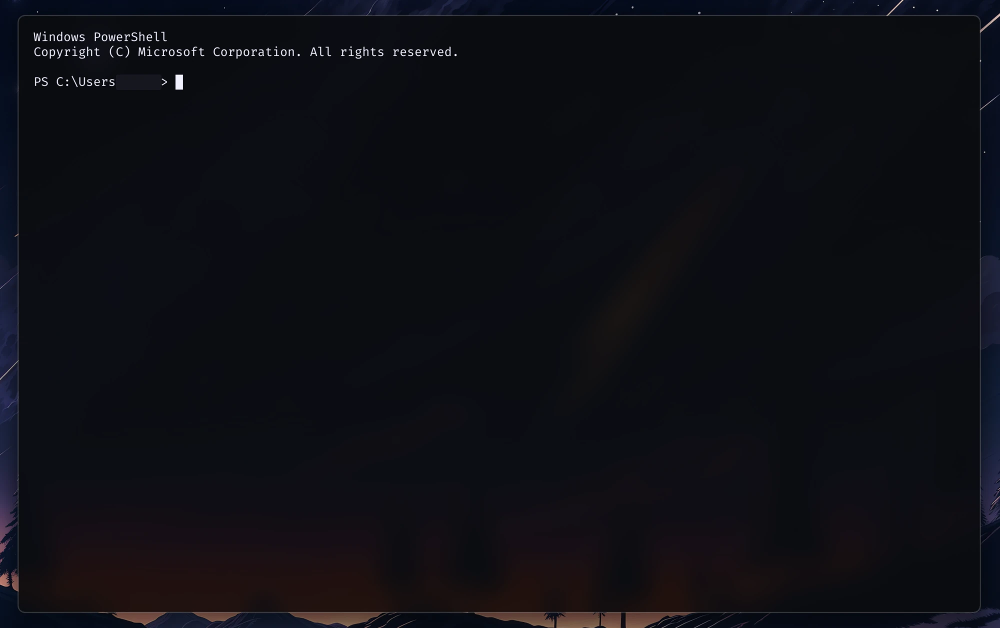
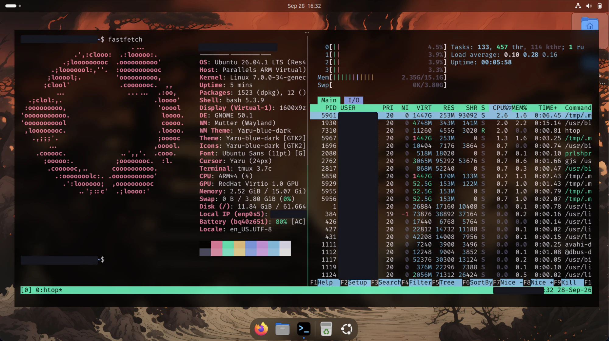
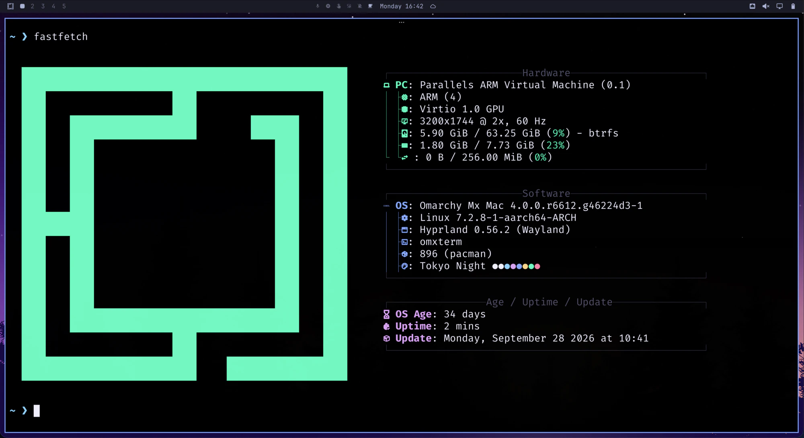

#  OMXTerm

OMXTerm is a fast, minimal, open-source desktop terminal you can make your own.
Open a few tabs, customize your theme and shortcuts, and get to work. Available
for **Apple Silicon macOS, Linux ARM64, and Windows ARM64 or x64**.

---

**Sponsor: Hostinger**

Need a VPS server (or any other hosting service)? Use my link and coupon code
for 10% discount:

- [hostinger.com/otaviomiranda](https://hostinger.com/otaviomiranda)
- Coupon: `OTAVIOMIRANDA`

---

_macOS, with background transparency and blur._

More screenshots: macOS, Windows, and Linux

**macOS — tabs and snippets**

**Fedora KDE Plasma**

**Windows**

**Ubuntu GNOME**

**Omarchy / Hyprland**

These setups use custom shell and desktop preferences. The tiled windows in the
Omarchy screenshot are arranged by Hyprland.

- **Ready out of the box:** starts your local shell with bundled Nerd Fonts and
  programming ligatures.
- **Make it yours:** customize themes, fonts, keyboard shortcuts, and reusable
  text snippets — in plain JSON or visually with
  [OMXTerm Studio](https://luizomf.github.io/omxterm-studio/).
- **Clean workspace:** tabs, multiple windows, hideable title and tab bars, and
  optional background transparency and blur.
- **Everyday conveniences:** drag files to insert quoted paths, click to preview
  local PNG/JPEG images, render inline Kitty images (Chafa and Pi), and use
  [Protected Paste](docs/usage.md#protected-paste).

Powered by [Restty](https://github.com/wiedymi/restty) and
[Ghostty](https://github.com/ghostty-org/ghostty)'s terminal core, OMXTerm works
great with your everyday CLI tools, TUI editors, SSH sessions, and coding
agents.

**[Install](#installation)** · **[First session](#first-session)** ·
**[Customize](docs/configuration.md)** · **[Everyday use](docs/usage.md)** ·
**[How it works](docs/how-it-works.md)** · **[Documentation](docs/README.md)**

## Platforms and downloads

**Latest release:
[0.21.0 — downloads and release notes](https://github.com/luizomf/omxterm/releases/tag/v0.21.0)**

Prebuilt packages target **Apple Silicon macOS, Linux ARM64, and Windows 11
ARM64 or x64**. Windows x64 validation uses emulation on Windows ARM64; native
Intel/AMD qualification remains pending. See the release notes for actual coverage.

| Platform                                 | Download                                                                                               | Checksum                                                                                                     |
| ---------------------------------------- | ------------------------------------------------------------------------------------------------------ | ------------------------------------------------------------------------------------------------------------ |
| Apple Silicon macOS                      | [DMG](https://github.com/luizomf/omxterm/releases/download/v0.21.0/OMXTerm-0.21.0-arm64.dmg)           | [SHA-256](https://github.com/luizomf/omxterm/releases/download/v0.21.0/OMXTerm-0.21.0-arm64.dmg.sha256)      |
| Linux ARM64                              | [AppImage](https://github.com/luizomf/omxterm/releases/download/v0.21.0/OMXTerm-0.21.0-arm64.AppImage) | [SHA-256](https://github.com/luizomf/omxterm/releases/download/v0.21.0/OMXTerm-0.21.0-arm64.AppImage.sha256) |
| Linux application-menu helper (optional) | [linux_install.sh](https://github.com/luizomf/omxterm/releases/download/v0.21.0/linux_install.sh)      | [SHA-256](https://github.com/luizomf/omxterm/releases/download/v0.21.0/linux_install.sh.sha256)              |
| Windows ARM64                            | [Installer](https://github.com/luizomf/omxterm/releases/download/v0.21.0/OMXTerm-0.21.0-arm64.exe)     | [SHA-256](https://github.com/luizomf/omxterm/releases/download/v0.21.0/OMXTerm-0.21.0-arm64.exe.sha256)      |
| Windows x64                              | [Installer](https://github.com/luizomf/omxterm/releases/download/v0.21.0/OMXTerm-0.21.0-x64.exe)       | [SHA-256](https://github.com/luizomf/omxterm/releases/download/v0.21.0/OMXTerm-0.21.0-x64.exe.sha256)        |

Linux requires **glibc 2.42+** and X11/XWayland (for example Fedora 43+, Ubuntu
25.10+, or Arch). First-launch notes for macOS Gatekeeper and Windows
SmartScreen are in the [installation guide](docs/installation.md).

### Tested desktops

OMXTerm is tested on Apple Silicon macOS, Windows 11 ARM64, and Linux ARM64
desktops including Fedora (GNOME and KDE Plasma), Ubuntu GNOME, Debian, and
Omarchy/Hyprland.

## Installation

Download the package for your system and follow the quick steps:

- **[macOS](docs/installation.md#macos):** open the DMG, drag OMXTerm to
  Applications, and launch.
- **[Linux](docs/installation.md#linux):** make the AppImage executable and run
  it, or use `linux_install.sh` to add it to your application menu.
- **[Windows](docs/installation.md#windows):** run the installer and launch
  OMXTerm from the Start menu.

## First session

When you open OMXTerm, it starts your default shell (such as Zsh, Bash, or
PowerShell) in your home folder. Each tab runs an independent session.

| Action             | macOS             | Linux and Windows   |
| ------------------ | ----------------- | ------------------- |
| New tab            | `Cmd+T`           | `Ctrl+Shift+T`      |
| Copy selected text | `Cmd+C`           | `Ctrl+Shift+C`      |
| Paste              | `Cmd+V`           | `Ctrl+Shift+V`      |
| Zoom in / out      | `Cmd++` / `Cmd+-` | `Ctrl++` / `Ctrl+-` |

`Ctrl+C` sends an interrupt signal to the running command. On Linux and Windows,
press and release **Alt** to open the application menu; on macOS, use the top
menu bar.

### Make it yours

On first launch, OMXTerm creates starter configuration files (`config.json`,
`snippets.yaml`, and `themes/omtheme.json`) in `~/.config/omxterm`. You can edit
them directly,
[tweak a single setting](docs/configuration.md#add-one-display-change), or use
[OMXTerm Studio](docs/configuration.md#edit-visually-with-omxterm-studio) to
customize your settings and colors visually.

See [Everyday use](docs/usage.md) for all keyboard shortcuts, image previews,
and tips.

## Updating or uninstalling

To update, download the latest release, quit OMXTerm, and replace the
application. Your custom settings, themes, and snippets are always kept intact.
See
[platform-specific update and uninstall steps](docs/installation.md#updating-or-uninstalling).

## Privacy and security

OMXTerm makes zero network requests and collects no telemetry. Local diagnostic
logs exclude your terminal output, commands, clipboard data, and settings. To
report a security vulnerability privately, see [SECURITY.md](SECURITY.md).

## Contributing

Bug reports, feedback, documentation improvements, and code contributions are
welcome!

- Found a bug or confusing step?
  [Open an issue](https://github.com/luizomf/omxterm/issues/new?template=bug-report.md).
- Want to build from source or contribute code? Read
  [CONTRIBUTING.md](CONTRIBUTING.md) and the
  [documentation index](docs/README.md), including open efforts to add
  [Linux x64](https://github.com/luizomf/omxterm/issues/223) packages.
  Windows x64 testing and feedback are welcome in
  [#224](https://github.com/luizomf/omxterm/issues/224).

## License

[MIT](LICENSE). Built with Restty, Ghostty, and other open-source components
listed in [Third-Party Notices](THIRD_PARTY_NOTICES.md).
