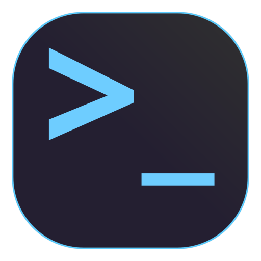

#  OMXTerm

OMXTerm is a fast, open-source desktop terminal for **macOS, Linux and Windows,
on ARM64 and x64**. It starts your shell in tabs and split panes, keeps your SSH
servers one click away, colors command output, and can be customized in plain
JSON, without sending anything over the network.

It is built with Electron and TypeScript on the
[Restty](https://github.com/wiedymi/restty) renderer and
[Ghostty](https://github.com/ghostty-org/ghostty)'s terminal core, and brings
the feature set of [AshyTerm](https://github.com/big-comm/ashyterm) to every
platform.

---

## Sponsor: Hostinger

Need a VPS server (or any other hosting service)? Use my link and coupon code
for 10% discount:

- [hostinger.com/otaviomiranda](https://hostinger.com/otaviomiranda)
- Coupon: `OTAVIOMIRANDA`

---


_macOS, with background transparency and blur._

<details>
<summary>More screenshots: macOS, Windows, and Linux</summary>

### macOS — tabs and snippets


### Fedora KDE Plasma


### Windows PowerShell


### Ubuntu GNOME


### Omarchy / Hyprland


These setups use custom shell and desktop preferences. The tiled windows in the
Omarchy screenshot are arranged by Hyprland.

</details>

**[Features](#features)** · **[Download](#platforms-and-downloads)** ·
**[Install](#installation)** · **[Shortcuts](#keyboard-shortcuts)** ·
**[Command line](#command-line)** · **[Configuration](#configuration)** ·
**[Build from source](#building-from-source)** ·
**[Architecture](#architecture)** · **[Documentation](docs/README.md)**

## Features

### Terminal

- GPU-rendered terminal (WebGL2) on Ghostty's VT core: true color, Unicode,
  wide characters and emoji, ligatures, and inline Kitty images (Chafa, Pi).
- Bundled Nerd Fonts (FiraCode, JetBrains Mono, DejaVu Sans Mono), or any
  installed font.
- Scrollback up to 100,000 lines and search through it (**Edit → Find…**).
- Clickable web links, previews of local PNG/JPEG images, and quoted file
  paths when you drop files on the window.
- **Protected Paste:** pasting multiple lines or control characters asks
  first.

### Workspace

- **Header toolbar** in the title bar: Sessions, Commands, Files, Find, Split Right,
  Split Down and Broadcast before the title; New Tab and a **main menu**
  (☰) with every action after it.
- Tabs and multiple windows, with hideable title and tab bars, background
  transparency and blur, and always-on-top.
- **Split panes:** split right or down (up to 16 panes per tab), move focus by
  direction, maximize, equalize, and drag dividers. New panes open in the
  current pane's folder.
- **Broadcast input:** type into every pane of a tab at once, after a
  confirmation, with a visible indicator.
- **Tab menu:** rename, color, duplicate, and group tabs into named groups
  that collapse behind a colored chip.
- **Restore Windows at Startup** (off by default): reopens your windows, tabs,
  splits, folders, connections and groups.
- **Command palette** to run any action by name.

### Sessions and SSH

- **Sessions sidebar** with folders, favorites, recent sessions and search.
- **Local sessions:** a working directory, a program with literal arguments,
  and a command typed once the shell is ready.
- **SSH sessions** through your system OpenSSH client, which supports:
  - user, port, key file and agent forwarding;
  - jump hosts and port forwards (`L`, `R`, `D`);
  - X11 forwarding, compression, and connection reuse;
  - a remote command and extra options.
- **Quick Connect** (`user@host:port`), import from `~/.ssh/config`, and JSON
  import and export.
- A failed connection keeps its screen with **Reconnect** and **Close**.
- Passwords are typed at ssh's own prompt and are never stored.

### Integrated file manager

- **Files sidebar** that follows the focused terminal's folder: browse,
  filter, open with the default app, show in the system file manager, create,
  rename, copy, move and move to the trash.
- **Remote files over SFTP** for SSH sessions, through your OpenSSH and the
  terminal's shared connection: browse, edit a remote file in a local app
  (each save is uploaded), download, upload, move and delete, with progress
  and cancel.
- Open a folder in the terminal or insert quoted paths with one click.

### Productivity

- **Output highlighting** (off by default): AshyTerm's 51 rule sets (486
  rules) color errors, warnings, IP addresses, URLs and more. The rule set is
  chosen by the command you run (`ping`, `df`, `systemctl`, `docker`, …). A
  rule editor manages rule sets, ignored commands and your own rules.
- **Command Manager:** 56 ready-made commands for Linux, macOS and Windows
  (files, archives, processes, services, packages, network, SSH, Git,
  Docker), plus your own templates.
  - Every command is previewed before it is inserted or run.
  - Programs that are not installed are flagged.
- **Snippets:** reusable text from `snippets.json`, inserted or run from a
  sidebar.

### Settings and data

- **Preferences window** (☰ → Preferences…, `Ctrl+Shift+X` / `Cmd+,`):
  14 color schemes (OMXTerm's own plus AshyTerm's BigLinux, Solarized,
  Monokai, Dracula, Nord, Tokyo Night, Catppuccin, Rosé Pine and more), font,
  size, line height, ligatures, transparency, blur, padding, scrollback,
  window and tab options, a shortcut recorder with conflict checks, and
  Restore Defaults. Every change is validated, saved to `config.json` and
  applied to all windows at once.
- Plain-JSON configuration with hot reload, themes, and remappable shortcuts,
  or edit visually with [OMXTerm Studio](https://luizomf.github.io/omxterm-studio/).
- **Back Up / Restore Settings:** one passphrase-encrypted `.omxbackup` file
  (scrypt and AES-256-GCM). Passwords and keys are never included.
- English and Brazilian Portuguese interface.
- No telemetry and no network requests of its own; see
  [Privacy and security](#privacy-and-security).

## Platforms and downloads

**Latest pre-release:
[0.21.0 — downloads and release notes](https://github.com/ruscher/omxterm/releases/tag/v0.21.0)**

| Platform                                 | Download                                                                                                | Checksum                                                                                                      |
| ---------------------------------------- | ------------------------------------------------------------------------------------------------------- | ------------------------------------------------------------------------------------------------------------- |
| Apple Silicon macOS                      | [DMG](https://github.com/ruscher/omxterm/releases/download/v0.21.0/OMXTerm-0.21.0-arm64.dmg)            | [SHA-256](https://github.com/ruscher/omxterm/releases/download/v0.21.0/OMXTerm-0.21.0-arm64.dmg.sha256)       |
| Intel macOS                              | [DMG](https://github.com/ruscher/omxterm/releases/download/v0.21.0/OMXTerm-0.21.0-x64.dmg)              | [SHA-256](https://github.com/ruscher/omxterm/releases/download/v0.21.0/OMXTerm-0.21.0-x64.dmg.sha256)         |
| Linux ARM64                              | [AppImage](https://github.com/ruscher/omxterm/releases/download/v0.21.0/OMXTerm-0.21.0-arm64.AppImage)  | [SHA-256](https://github.com/ruscher/omxterm/releases/download/v0.21.0/OMXTerm-0.21.0-arm64.AppImage.sha256)  |
| Linux ARM64 (Debian, Ubuntu)             | [DEB](https://github.com/ruscher/omxterm/releases/download/v0.21.0/OMXTerm-0.21.0-arm64.deb)            | [SHA-256](https://github.com/ruscher/omxterm/releases/download/v0.21.0/OMXTerm-0.21.0-arm64.deb.sha256)       |
| Linux ARM64 (Fedora, openSUSE)           | [RPM](https://github.com/ruscher/omxterm/releases/download/v0.21.0/OMXTerm-0.21.0-aarch64.rpm)          | [SHA-256](https://github.com/ruscher/omxterm/releases/download/v0.21.0/OMXTerm-0.21.0-aarch64.rpm.sha256)     |
| Linux x64                                | [AppImage](https://github.com/ruscher/omxterm/releases/download/v0.21.0/OMXTerm-0.21.0-x86_64.AppImage) | [SHA-256](https://github.com/ruscher/omxterm/releases/download/v0.21.0/OMXTerm-0.21.0-x86_64.AppImage.sha256) |
| Linux x64 (Debian, Ubuntu)               | [DEB](https://github.com/ruscher/omxterm/releases/download/v0.21.0/OMXTerm-0.21.0-amd64.deb)            | [SHA-256](https://github.com/ruscher/omxterm/releases/download/v0.21.0/OMXTerm-0.21.0-amd64.deb.sha256)       |
| Linux x64 (Fedora, openSUSE)             | [RPM](https://github.com/ruscher/omxterm/releases/download/v0.21.0/OMXTerm-0.21.0-x86_64.rpm)           | [SHA-256](https://github.com/ruscher/omxterm/releases/download/v0.21.0/OMXTerm-0.21.0-x86_64.rpm.sha256)      |
| Linux application-menu helper (optional) | [linux_install.sh](https://github.com/ruscher/omxterm/releases/download/v0.21.0/linux_install.sh)       | [SHA-256](https://github.com/ruscher/omxterm/releases/download/v0.21.0/linux_install.sh.sha256)               |
| Windows ARM64                            | [Installer](https://github.com/ruscher/omxterm/releases/download/v0.21.0/OMXTerm-0.21.0-arm64.exe)      | [SHA-256](https://github.com/ruscher/omxterm/releases/download/v0.21.0/OMXTerm-0.21.0-arm64.exe.sha256)       |
| Windows x64                              | [Installer](https://github.com/ruscher/omxterm/releases/download/v0.21.0/OMXTerm-0.21.0-x64.exe)        | [SHA-256](https://github.com/ruscher/omxterm/releases/download/v0.21.0/OMXTerm-0.21.0-x64.exe.sha256)         |

Arch Linux, Manjaro and BigLinux build a native package with the included
`PKGBUILD` ([below](#arch-linux-manjaro-and-biglinux)).

### Requirements

- **macOS:** 12 Monterey or newer, Apple Silicon or Intel.
- **Windows:** Windows 10 or 11, ARM64 or x64.
- **Linux:** ARM64 or x64, glibc 2.34 or newer (Ubuntu 22.04+, Debian 12+,
  Fedora 35+, Arch, Manjaro, BigLinux), an X11 or XWayland session, and a GPU
  with WebGL2 (Mesa's software renderer works with `--ignore-gpu-blocklist`).
- **SSH sessions:** an OpenSSH client (`ssh`, or `ssh.exe` on Windows).

### Signing

The packages are **not signed**. macOS builds carry only an ad-hoc signature,
without Apple Developer ID signing or notarization. Verify the SHA-256
checksum before you install:

- **macOS:** use **System Settings → Privacy & Security → Open Anyway** on
  first launch.
- **Windows:** choose **More info → Run anyway** in SmartScreen.

### Tested desktops

OMXTerm is tested on:

- macOS and Windows 11;
- Linux with Fedora (GNOME and KDE Plasma), Ubuntu GNOME, Debian,
  Omarchy/Hyprland, Manjaro and BigLinux (KDE Plasma).

## Installation

Full steps, checksums, updates and removal for every system are in the
[installation guide](docs/installation.md).

### macOS

Open the DMG, drag OMXTerm to **Applications**, and launch it.

### Windows

Run the installer and start OMXTerm from the Start menu.

### Debian and Ubuntu

```sh
sudo apt install ./OMXTerm-0.21.0-amd64.deb    # arm64: OMXTerm-0.21.0-arm64.deb
```

### Fedora, openSUSE and other RPM systems

```sh
sudo dnf install ./OMXTerm-0.21.0-x86_64.rpm   # arm64: OMXTerm-0.21.0-aarch64.rpm
# openSUSE: sudo zypper install --allow-unsigned-rpm ./OMXTerm-0.21.0-x86_64.rpm
```

### AppImage (any Linux)

```sh
chmod +x OMXTerm-0.21.0-x86_64.AppImage
./OMXTerm-0.21.0-x86_64.AppImage
# Optional: add it to your application menu
sh linux_install.sh install OMXTerm-0.21.0-x86_64.AppImage
```

### Arch Linux, Manjaro and BigLinux

`pkgbuild/PKGBUILD` follows BigLinux's packaging layout. It clones this
repository, builds for your architecture (x86_64 or aarch64), and versions
the package by build date. The build downloads npm packages and Electron.

```sh
sudo pacman -S --needed base-devel git nodejs npm
mkdir omxterm-pkg && cd omxterm-pkg
curl -fLO https://raw.githubusercontent.com/ruscher/omxterm/main/pkgbuild/PKGBUILD
makepkg -si
```

From a checkout, `packaging/arch/PKGBUILD` builds the same package from your
local source tree (`cd packaging/arch && makepkg -si`).

The package installs:

- `/usr/lib/omxterm`: the application;
- `/usr/bin/omxterm`: the launcher;
- the menu entry, theme icons from 16 px to scalable, and licenses.

Remove it with `sudo pacman -R omxterm`.

## First session

OMXTerm starts your default shell (Zsh, Bash, Fish, PowerShell, …) in your
home folder. Each tab and pane runs its own session. `Ctrl+C` interrupts the
running command.

The toolbar in the title bar opens the sidebars and splits panes, and the
**☰** button opens the main menu with everything else, including
**Preferences…**. On Linux and Windows, pressing and releasing **Alt** also
opens the application menu; on macOS, use the menu bar.

On first launch OMXTerm creates `config.json`, `snippets.json` and
`themes/omtheme.json` in its [configuration folder](#configuration).

## Keyboard shortcuts

Every shortcut can be changed in **Preferences → Shortcuts**, or under
`keybinds` in `config.json` (the action names are in the second column), and
the menus always show the active ones.

| Action                  | `keybinds` name                      | macOS                        | Linux and Windows              |
| ----------------------- | ------------------------------------ | ---------------------------- | ------------------------------ |
| New window              | `newWindow`                          | `Cmd+N`                      | `Ctrl+Shift+N`                 |
| New tab                 | `newTab`                             | `Cmd+T`                      | `Ctrl+Shift+T`                 |
| Close tab               | `closeTab`                           | `Cmd+W`                      | `Ctrl+Shift+W`                 |
| Close window            | `closeWindow`                        | `Cmd+Shift+W`                | `Ctrl+Shift+Q`                 |
| Quit                    | `quit`                               | `Cmd+Q`                      | `Ctrl+Alt+Shift+Q`             |
| Next / previous tab     | `nextTab`, `previousTab`             | `Ctrl+Tab`, `Ctrl+Shift+Tab` | `Ctrl+PageDown`, `Ctrl+PageUp` |
| Tab 1 … 9               | `selectTab1` … `selectTab9`          | `Cmd+1` … `Cmd+9`            | `Alt+1` … `Alt+9`              |
| Copy / paste            | `copy`, `paste`                      | `Cmd+C`, `Cmd+V`             | `Ctrl+Shift+C`, `Ctrl+Shift+V` |
| Select all              | `selectAll`                          | `Cmd+A`                      | `Ctrl+Shift+A`                 |
| Find in terminal        | `find`                               | `Cmd+F`                      | `Ctrl+Shift+G`                 |
| Command palette         | `commandPalette`                     | `Cmd+Shift+P`                | `Ctrl+Shift+P`                 |
| Zoom in / out / reset   | `zoomIn`, `zoomOut`, `actualSize`    | `Cmd++`, `Cmd+-`, `Cmd+0`    | `Ctrl++`, `Ctrl+-`, `Ctrl+0`   |
| Split right             | `splitRight`                         | `Cmd+D`                      | `Ctrl+Shift+O`                 |
| Split down              | `splitDown`                          | `Cmd+Shift+E`                | `Ctrl+Shift+E`                 |
| Close pane              | `closePane`                          | `Cmd+Alt+W`                  | `Ctrl+Shift+K`                 |
| Next / previous pane    | `focusNextPane`, `focusPreviousPane` | `Cmd+]`, `Cmd+[`             | `Ctrl+Shift+]`, `Ctrl+Shift+[` |
| Pane left/right/up/down | `focusPaneLeft` … `focusPaneDown`    | `Cmd+Alt+Arrow`              | `Alt+Shift+Arrow`              |
| Maximize / restore pane | `toggleMaximizePane`                 | `Cmd+Shift+Enter`            | `Ctrl+Shift+Z`                 |
| Equalize panes          | `equalizePanes`                      | `Cmd+Alt+0`                  | `Ctrl+Shift+0`                 |
| Broadcast input         | `toggleBroadcast`                    | `Cmd+Alt+I`                  | `Ctrl+Shift+I`                 |
| Sessions sidebar        | `toggleSessions`                     | `Cmd+Shift+J`                | `Ctrl+Shift+H`                 |
| Commands sidebar        | `toggleCommands`                     | `Cmd+Shift+M`                | `Ctrl+Shift+M`                 |
| Snippets sidebar        | `toggleSnippets`                     | `Cmd+Shift+S`                | `Ctrl+Shift+S`                 |
| Tab bar / title bar     | `toggleTabBar`, `toggleTitleBar`     | `Cmd+Shift+B`, `Cmd+Shift+D` | `Ctrl+Shift+B`, `Ctrl+Shift+D` |
| Full screen             | `toggleFullScreen`                   | `Ctrl+Cmd+F`                 | `Ctrl+Shift+F`                 |
| Reload configuration    | `reloadConfig`                       | `Cmd+Shift+,`                | `Ctrl+Shift+,`                 |
| Preferences             | `preferences`                        | `Cmd+,`                      | `Ctrl+Shift+X`                 |
| Files sidebar           | `toggleFiles`                        | `Cmd+Shift+L`                | `Ctrl+Shift+L`                 |

Without a shortcut: **File → Open Local Image…**, **Back Up Settings…**,
**Restore Settings…**; **View → Highlight Output**, **Highlight Rules…**,
**Toggle Developer Tools**; **Window → Always on Top**; and **Restore Windows
at Startup** in the application menu. Right-click a tab (or `Shift+F10`) for
its menu.

## Command line

```text
omxterm [options] [-e <program> [arguments...]]

  -w, --working-directory <dir>  Start the first tab in <dir>
  --ssh <[user@]host[:port]>     Open the first tab as an SSH connection
  --log-level <error|info|debug> Override logLevel for this run
  --debug                        Same as --log-level debug
  -e <program> [arguments...]    Run <program> with literal arguments in
                                 the first tab instead of the shell
  -v, --version                  Print the version and exit
  -h, --help                     Print this help and exit
```

- Everything after `-e` goes to the program unchanged: no shell, no quoting.
- `--ssh` cannot be combined with `-e` or `-w`.
- An invalid option exits with status 2.
- Each launch opens a new window in a new process. On macOS, run
  `/Applications/OMXTerm.app/Contents/MacOS/OMXTerm`.

## Configuration

OMXTerm reads its files from `$XDG_CONFIG_HOME/omxterm` (by default
`~/.config/omxterm` on macOS and Linux, and `%USERPROFILE%\.config\omxterm` on
Windows).

| File               | Written by          | Contents                                                              |
| ------------------ | ------------------- | --------------------------------------------------------------------- |
| `config.json`      | you, or Preferences | Fonts, padding, scrollback, window options, theme, shortcuts          |
| `snippets.json`    | you                 | Snippets for the Snippets sidebar                                     |
| `themes/*.json`    | you, or Preferences | Terminal color themes (built-in schemes are written here when chosen) |
| `sessions.json`    | OMXTerm             | Saved sessions and folders                                            |
| `highlights.json`  | OMXTerm             | Output highlighting switches and rules                                |
| `commands.json`    | OMXTerm             | Custom commands, favorites, hidden built-ins                          |
| `workspace.json`   | OMXTerm             | Windows to restore at startup (only when enabled)                     |
| `credentials.json` | OMXTerm             | Encrypted secrets, protected by the system keychain                   |

Every `config.json` key is optional except `"version": 1`:

```json
{
  "version": 1,
  "font": { "family": "JetBrainsMono Nerd Font Mono", "size": 15 },
  "scrollback": { "lines": 20000 },
  "window": { "transparency": 0.1, "blur": true, "showTabBar": true },
  "theme": { "path": "themes/omtheme.json" },
  "keybinds": { "splitRight": "Control+Shift+D" }
}
```

- **Reloading:** changes apply on save or with **Reload Configuration**. An
  invalid file keeps the last good configuration and shows a banner that
  explains the problem.
- **Damaged files:** a damaged file that OMXTerm writes itself is set aside as
  `<name>.corrupt-<time>`, never silently lost.
- **Reference:** the full list of keys, themes and examples is in the
  [configuration guide](docs/configuration.md).

Diagnostic logs (two files of at most 5 MiB) are in
`$XDG_STATE_HOME/omxterm/logs` (by default `~/.local/state/omxterm/logs`).

## Privacy and security

- OMXTerm makes no network requests of its own and collects no telemetry. SSH
  connections start only when you open one.
- Logs record application events only: never terminal output, commands,
  clipboard data, paths or configuration values.
- Passwords and keys are never written to disk in plain text and never
  included in backups or exports. SSH passwords are typed at ssh's prompt.
- The interface runs in an isolated renderer without Node.js. Only the main
  process starts programs, always with literal argument lists, never shell
  strings. Imported SSH settings that would run local programs
  (`ProxyCommand`, `LocalCommand`, …) are refused.

To report a vulnerability privately, see [SECURITY.md](SECURITY.md). The
detailed model is in
[docs/implementation/03-security-and-privacy.md](docs/implementation/03-security-and-privacy.md).

## Building from source

### Prerequisites

- Node.js 24 (or 22.13+) and npm, Git, and a C++ compiler (node-pty is
  compiled for your machine).
- Linux packaging: `rpmbuild`, `rpm2cpio`, `cpio`, `ar` and `file`. On ARM64
  hosts, also `fpm`.
- Platform details are in [docs/development.md](docs/development.md).

```sh
git clone https://github.com/ruscher/omxterm.git
cd omxterm
npm ci
npm run dev
```

### Scripts

| Command                                       | What it does                                                            |
| --------------------------------------------- | ----------------------------------------------------------------------- |
| `npm run dev`                                 | Builds and launches OMXTerm from the source tree                        |
| `npm run build`                               | Bundles main, preload and renderer into `dist/` with esbuild            |
| `npm test -- test/unit`                       | Headless unit tests (Vitest, with jsdom for the interface)              |
| `npm test`                                    | Unit tests plus the graphical integration suites (opens real windows)   |
| `npm run lint` / `npm run typecheck`          | oxlint with type-aware rules / TypeScript                               |
| `npm run format` / `npm run format:check`     | Prettier                                                                |
| `npm run check:portable`                      | Format check, lint, types, tests and build                              |
| `npm run package:linux` / `:mac` / `:win`     | Builds and packages for the host platform and architecture              |
| `npm run package:verify`                      | Verifies the packages (architecture, native modules, licenses, startup) |
| `npm run check:linux` / `check` / `check:win` | Everything above for that platform                                      |
| `node scripts/generate-application-icons.mjs` | Regenerates every icon from the SVG source (needs `rsvg-convert`)       |

Packages are written to `release/`:

- **macOS:** DMG.
- **Linux:** AppImage, DEB, RPM, and `linux_install.sh`.
- **Windows:** NSIS installer.

Each comes with `.sha256` files. Every host packages its own architecture,
because native modules are never cross-compiled. The release procedure is in
[docs/release.md](docs/release.md).

## Architecture

| Layer                   | Role                                                                                                                                           |
| ----------------------- | ---------------------------------------------------------------------------------------------------------------------------------------------- |
| `src/main/`             | Electron main process: windows, menus, PTY sessions (node-pty), SSH launch, configuration, Application Data, backup, Credential Store, logging |
| `src/preload/`          | A frozen `window.omxterm` bridge that validates every message in both directions                                                               |
| `src/renderer/`         | Tabs, split panes, sidebars, dialogs, command palette, output highlighter; runs with context isolation and without Node.js                     |
| `src/terminal-surface/` | Restty and Ghostty WASM terminal surface, independent of Electron                                                                              |
| `src/shared/`           | Typed IPC contracts, validators, translations, built-in commands, highlight rules, icons                                                       |

- **Stack:** Electron 43, TypeScript 7, Restty 0.3 (Ghostty WASM core),
  node-pty 1.1, esbuild, Vitest, oxlint, Prettier, electron-builder.
- **CI:** GitHub Actions on six runners (Linux, macOS and Windows, each on
  x64 and ARM64) runs format, lint, types, unit tests, build, native PTY
  suites and packaging with verification.
- **Design records:**
  - [docs/spec.md](docs/spec.md): product specification.
  - [CONTEXT.md](CONTEXT.md): domain vocabulary.
  - [docs/adr/](docs/adr/README.md): 36 architecture decision records.
  - [docs/implementation/](docs/implementation/): engineering records,
    including the AshyTerm parity matrix.

## Documentation

- [Installation](docs/installation.md) · [Everyday use](docs/usage.md) ·
  [Configuration](docs/configuration.md) · [How it works](docs/how-it-works.md)
- [Linux desktop integration](docs/linux-desktop.md) ·
  [Linux installer](docs/linux-installer.md)
- [Development](docs/development.md) · [Release](docs/release.md) ·
  [Versioning](docs/versioning.md) · [Documentation index](docs/README.md)

## Contributing

Bug reports, feedback, translations, documentation and code are welcome.

- [Open an issue](https://github.com/ruscher/omxterm/issues/new) for bugs or
  confusing steps.
- Read [CONTRIBUTING.md](CONTRIBUTING.md) before sending code. It covers the
  engineering standards, tests and pull request workflow.

### Contributors

- **Luiz Otávio Miranda**: creator and maintainer of OMXTerm.
- **Rafael Ruscher** ([rruscher@gmail.com](mailto:rruscher@gmail.com)):
  collaborator. Brought
  AshyTerm's feature set, x64 and native Linux packages, and the BigLinux
  package.

## License

[MIT](LICENSE). OMXTerm includes open-source components such as Electron,
Restty, Ghostty, node-pty, the bundled fonts, and AshyTerm's highlight rules
(MIT), listed in [Third-Party Notices](THIRD_PARTY_NOTICES.md).
