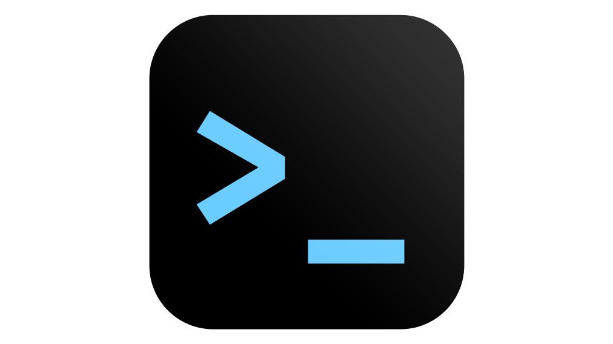
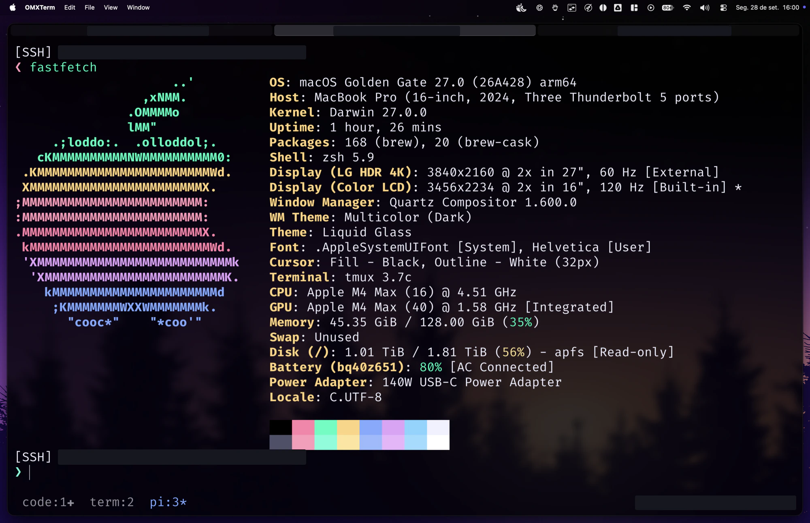
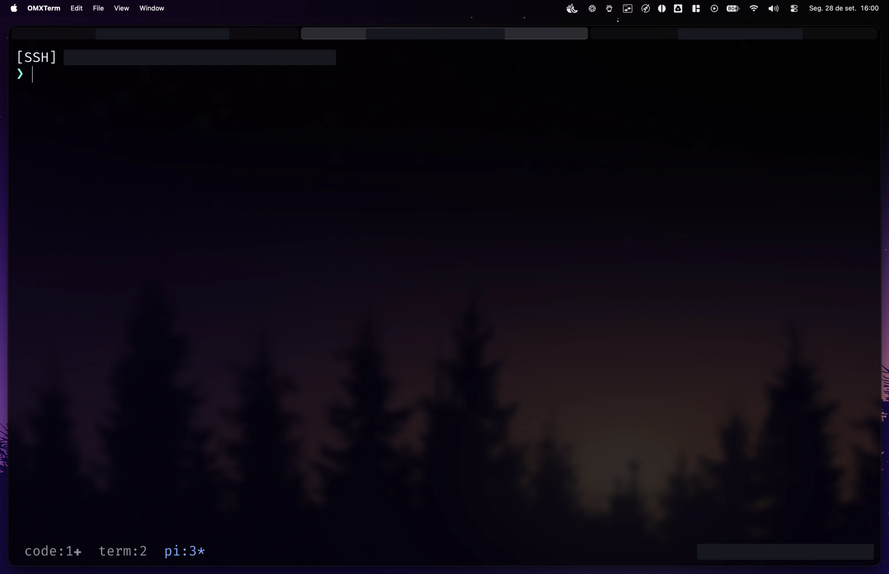
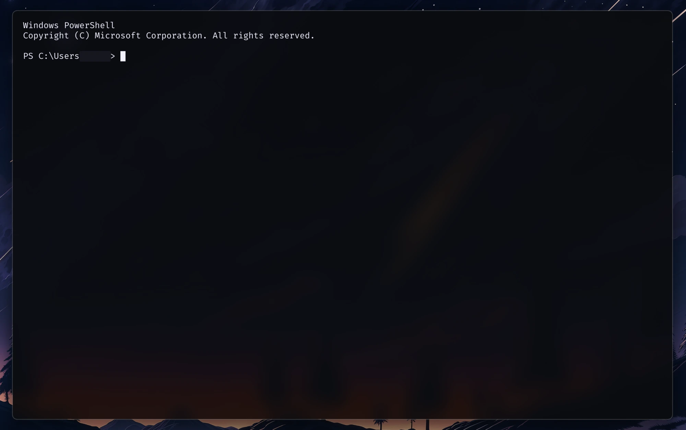
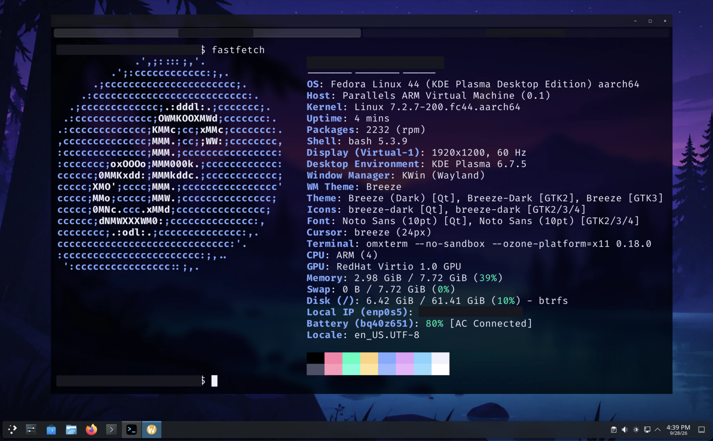
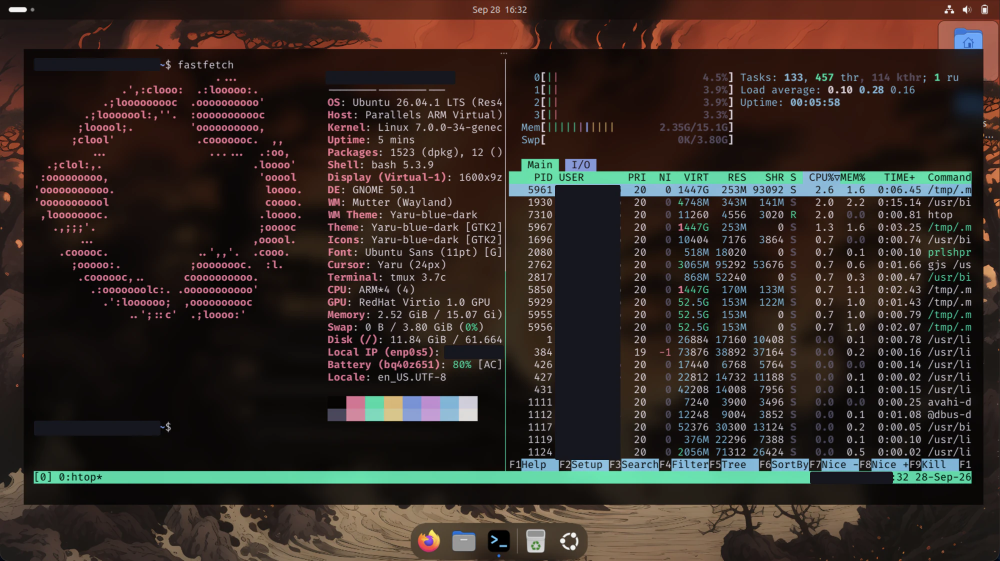
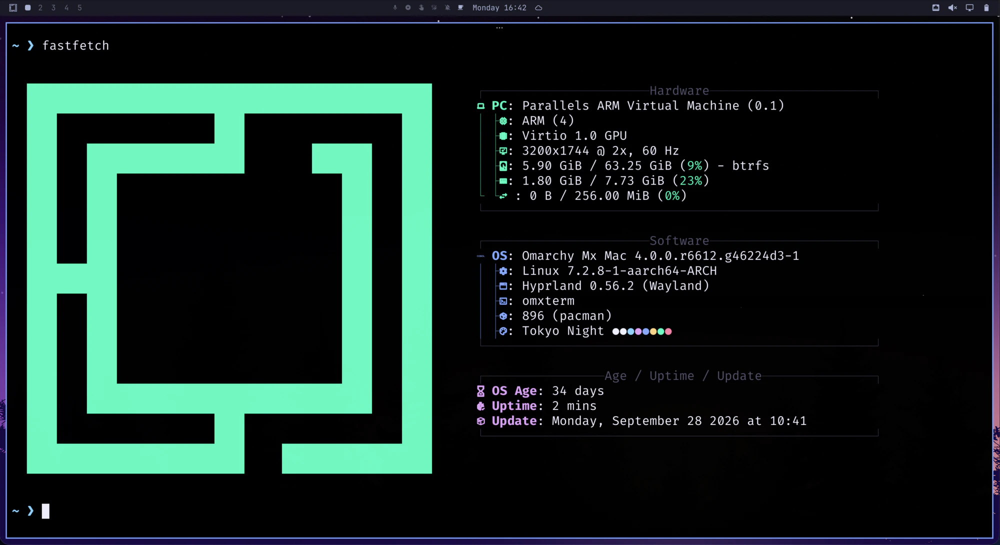

#  OMXTerm

OMXTerm is a free, open-source desktop terminal for macOS, Linux, and Windows.
A terminal is the window where you type commands; OMXTerm gives that window
tabs, themes, and shortcuts, and runs the shell your computer already has (the
program that runs the commands you type).



_macOS, with background transparency and blur._

<details>
<summary>More screenshots</summary>

**macOS — tabs and snippets**



**Windows**



**Fedora KDE Plasma**



**Ubuntu GNOME**



**Omarchy / Hyprland**



</details>

## Why OMXTerm

- **Your own shell.** Your prompt, aliases, and history work as usual; tabs,
  multiple windows, and hideable bars keep the screen clean.
- **Looks the way you want.** Bundled fonts include the symbols command-line
  tools print and joined-up pairs (ligatures). Themes, transparency, and blur
  are built in.
- **Fewer small mistakes.** Drag a file in to insert its path, hold Cmd or Ctrl
  and click an image path to preview it, and Protected Paste can ask before a
  multi-line paste runs.

**[Install](#platforms-and-downloads)** · **[First session](#first-session)** ·
**[Customize](docs/configuration.md)** · **[Everyday use](docs/usage.md)** ·
**[How it works](docs/how-it-works.md)** · **[Documentation](docs/README.md)**

## Platforms and downloads

OMXTerm runs on Apple Silicon Macs and on Linux and Windows PCs with ARM64 or
Intel/AMD processors. The x64 builds are **build-only**: automated checks ran,
but their desktop, graphics, installer, and everyday use have not been tested.
If one misbehaves,
[report it](https://github.com/luizomf/omxterm/issues/new?template=bug-report.md).

### Mac with an M-series chip

Choose **Apple Silicon macOS**; there is no Intel Mac build. To check, choose
Apple menu → **About This Mac** and look for an Apple M-series chip. The first
launch needs your explicit permission; step 4 shows where.

1. Download the DMG (the Mac app file) from the table below.
2. Open it and drag **OMXTerm.app** to **Applications**.
3. Open OMXTerm. macOS refuses to open it because Apple has not verified this
   app.
4. Verify the download using the checksum steps in the [installation
   guide](docs/installation.md#first-launch-on-macos), then allow it in **System
   Settings → Privacy & Security**: scroll to **Security** and click **Open
   Anyway** next to the OMXTerm message. On macOS 12, use **System Preferences
   → Security & Privacy → General**.
5. Open OMXTerm again. You only do this once.

### Linux PC

Choose **Linux ARM64** for an ARM PC or **Linux x64** for Intel/AMD. To check,
open your app launcher, search for **Terminal**, and run `uname -m`: `aarch64`
means ARM64 and `x86_64` means x64. Any other result has no matching download.

**The ARM64 AppImage requires glibc 2.42 or newer.** glibc is the core system
library your Linux distribution ships. Releases with an older glibc, such as
Ubuntu 24.04 LTS, are not supported; the
[Linux steps](docs/installation.md#requirements) show how to check and what to
do instead. OMXTerm uses X11, a Linux window system. On Wayland desktops, a
compatibility layer called XWayland lets X11 apps run; most desktops already
provide it.

The x64 AppImage is build-only.

1. Download the AppImage (a single file you run without installing) for your
   architecture from the table below.
2. Make it executable and run it; the [Linux
   steps](docs/installation.md#linux) have both commands.

### Windows PC

Windows 11 ARM64 is tested; Windows 11 x64 and Windows 10 are untested. Choose
**Windows ARM64** for an ARM PC (such as one with Snapdragon) or **Windows x64**
for Intel/AMD; the x64 build is build-only. If unsure, check **System type** in
**Settings → System → About**; a Surface can be either.

1. Install the
   [Microsoft Visual C++ Redistributable](https://learn.microsoft.com/en-us/cpp/windows/latest-supported-vc-redist)
   if you do not have it.
2. Download and run the installer for your architecture from the table below.
3. The installer is unsigned, so Windows may warn about an unrecognized app.
   Click **More info → Run anyway** after you verify the download.
4. Open **OMXTerm** from the Start menu.

### Downloads

The DMG, installer, and AppImage are the app downloads. The Linux helper
installs OMXTerm and adds a menu entry; it is not the app. `.sha256` files check
a download.

| Platform                 | App version | Download                                                                                                                                                                                                 | Checksum                                                                                                                                                                                                                      | Notes                                                                    |
| ------------------------ | ----------- | -------------------------------------------------------------------------------------------------------------------------------------------------------------------------------------------------------- | ----------------------------------------------------------------------------------------------------------------------------------------------------------------------------------------------------------------------------- | ------------------------------------------------------------------------ |
| Apple Silicon macOS      | 0.25.0      | [DMG](https://github.com/luizomf/omxterm/releases/download/v0.25.0/OMXTerm-0.25.0-arm64.dmg)                                                                                                             | [SHA-256](https://github.com/luizomf/omxterm/releases/download/v0.25.0/OMXTerm-0.25.0-arm64.dmg.sha256)                                                                                                                       | [Release notes](https://github.com/luizomf/omxterm/releases/tag/v0.25.0) |
| Linux ARM64              | 0.25.0      | [AppImage](https://github.com/luizomf/omxterm/releases/download/v0.25.0/OMXTerm-0.25.0-arm64.AppImage), [optional helper](https://github.com/luizomf/omxterm/releases/download/v0.25.0/linux_install.sh) | [AppImage SHA-256](https://github.com/luizomf/omxterm/releases/download/v0.25.0/OMXTerm-0.25.0-arm64.AppImage.sha256), [helper SHA-256](https://github.com/luizomf/omxterm/releases/download/v0.25.0/linux_install.sh.sha256) | [Release notes](https://github.com/luizomf/omxterm/releases/tag/v0.25.0) |
| Linux x64 (build-only)   | 0.25.0      | [AppImage](https://github.com/luizomf/omxterm/releases/download/v0.25.0/OMXTerm-0.25.0-x64.AppImage), [optional helper](https://github.com/luizomf/omxterm/releases/download/v0.25.0/linux_install.sh)   | [AppImage SHA-256](https://github.com/luizomf/omxterm/releases/download/v0.25.0/OMXTerm-0.25.0-x64.AppImage.sha256), [helper SHA-256](https://github.com/luizomf/omxterm/releases/download/v0.25.0/linux_install.sh.sha256)   | [Release notes](https://github.com/luizomf/omxterm/releases/tag/v0.25.0) |
| Windows ARM64            | 0.25.0      | [Installer](https://github.com/luizomf/omxterm/releases/download/v0.25.0/OMXTerm-0.25.0-arm64.exe)                                                                                                       | [SHA-256](https://github.com/luizomf/omxterm/releases/download/v0.25.0/OMXTerm-0.25.0-arm64.exe.sha256)                                                                                                                       | [Release notes](https://github.com/luizomf/omxterm/releases/tag/v0.25.0) |
| Windows x64 (build-only) | 0.25.0      | [Installer](https://github.com/luizomf/omxterm/releases/download/v0.25.0/OMXTerm-0.25.0-x64.exe)                                                                                                         | [SHA-256](https://github.com/luizomf/omxterm/releases/download/v0.25.0/OMXTerm-0.25.0-x64.exe.sha256)                                                                                                                         | [Release notes](https://github.com/luizomf/omxterm/releases/tag/v0.25.0) |

Platforms can ship at different times; the
[installation guide](docs/installation.md) has requirements and checksum
commands.

Earlier OMXTerm versions were tested on Apple Silicon macOS, Windows 11 ARM64,
and Linux ARM64 desktops: Debian 13.4 (KDE Plasma), Fedora 44 (GNOME and KDE
Plasma), Ubuntu 26.04 GNOME, and Omarchy/Hyprland.

Debian 13.4 is below the glibc requirement, so the current ARM64 package is not
supported there. On Intel/AMD Debian, use the build-only x64 build; on ARM64,
build from source as a development path.

## First session

OMXTerm opens with your shell in your home folder and a prompt ending in `%`,
`$`, or `>`. Type this and press Enter:

```sh
pwd
```

It prints the folder you are in: your home folder on first launch, such as
`/Users/yourname`, `/home/yourname`, or `C:\Users\yourname`.

| Action             | macOS             | Linux and Windows   |
| ------------------ | ----------------- | ------------------- |
| New tab            | `Cmd+T`           | `Ctrl+Shift+T`      |
| Copy selected text | `Cmd+C`           | `Ctrl+Shift+C`      |
| Paste              | `Cmd+V`           | `Ctrl+Shift+V`      |
| Zoom in / out      | `Cmd++` / `Cmd+-` | `Ctrl++` / `Ctrl+-` |

`Ctrl+C` stops the running command. On Linux and Windows, press and release
**Alt** to open the application menu; on macOS, use the menu bar.

### Make it yours

Choose **Settings…** in the application menu to change the font, theme, and
shortcuts. Themes and snippets live in files; the
[configuration guide](docs/configuration.md) shows where. See
[Everyday use](docs/usage.md) for all shortcuts and image previews.

## Optional tools

Files and SSH Connect are optional add-ons you install from inside OMXTerm.
Snippets comes with the app; a new installation tries to add it once on most
systems. See [Optional tools](docs/installation.md#optional-tools).

## Updating or uninstalling

OMXTerm does not update itself. To update, quit, download the new version, and
replace it; on macOS, drag the new **OMXTerm.app** into
**Applications**. Settings, themes, and snippets are kept. See
[update and uninstall steps](docs/installation.md#updating-or-uninstalling).

## Privacy and security

OMXTerm collects no telemetry and does not download or update extensions on its
own. On most systems, a new installation tries once to add the bundled Snippets
0.1.0 from the app's own files. Windows is not verified to stay network-silent:
one check saw system-proxy traffic but no Snippets download. Logs exclude
terminal output, commands, clipboard and settings. See the
[Windows availability limits](docs/snippets-availability.md#windows-arm64-known-issue).
Report vulnerabilities through [SECURITY.md](SECURITY.md).

## Contributing

Bug reports, documentation fixes, and code are welcome: read
[CONTRIBUTING.md](CONTRIBUTING.md) and
[open an issue](https://github.com/luizomf/omxterm/issues/new?template=bug-report.md).
Testing the build-only x64 packages is welcome in
[Linux #223](https://github.com/luizomf/omxterm/issues/223) and
[Windows #224](https://github.com/luizomf/omxterm/issues/224).

## License

[MIT](LICENSE). Built with Restty, Ghostty, and other open-source components
listed in [Third-Party Notices](THIRD_PARTY_NOTICES.md).

---

**Sponsor: Hostinger** — VPS and other hosting, 10% off with
[this link](https://hostinger.com/otaviomiranda) and coupon `OTAVIOMIRANDA`.
